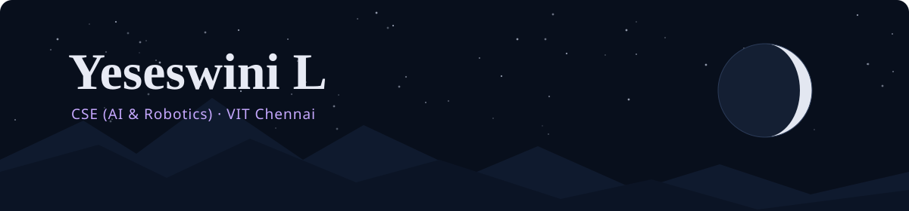
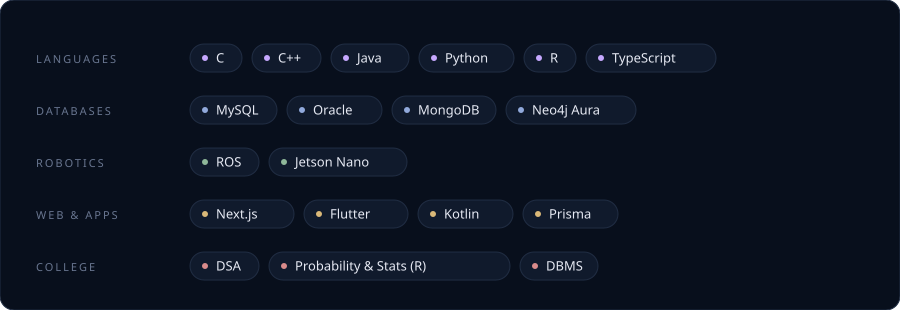
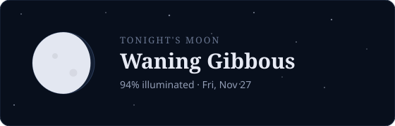

  

  

  CSE (AI & Robotics) @ VIT Chennai

---

### what i know

  

---

### 🌙 tonight's moon

  
   
  redrawn every night from the real lunar phase

---

### some of my works

**robots & simulations**

- **[JetBot Pro](https://github.com/yeses03/jetbotpro)** - ROS on the WaveShare JetBot (NVIDIA Jetson Nano). 
- **[Maglev Train Simulator](https://github.com/yeses03/Maglev-Train-Simulator)** - a train that floats 🚄 PID-controlled levitation, linear-motor propulsion, air drag, and coils that overheat and shut down. ([v1 here](https://github.com/yeses03/Maglev-Simulation))
- **indoor assistance system for the visually impaired** *(private, college IDP project)* - helping people find their way around unfamiliar public buildings

**apps & web**

- **[Commit Arena](https://github.com/yeses03/Git-Tracker)** - a leaderboard for my github commit contest with friends, because competition works. [live site](https://git-tracker-tqxb.onrender.com/)
- **[Java Practice IDE](https://github.com/yeses03/java-practice-ide)** - a LeetCode-style practice tool on my own machine: paste a question, write Java, it judges the code
- **WorkPass** *(private)* - Flutter app that turns gig-work income into something banks trust, with a "WorkScore". [demo](https://flutter-sprint.vercel.app)
- **Placement Automation System** *(private)* - placement management with admin tools for jobs and companies
- **Luna** *(private)* - my personalised fork of an open-source AI project-management assistant (Markdown + Git + local LLM)

**games**

- **[Wordle](https://github.com/yeses03/Wordle_Enactus)** and **[Grid Sequence Memory](https://github.com/yeses03/GridSequenceMemory_Enactus)** - built for the Enactus club expo 2026

**college**

- **[RStudio - Probability & Statistics](https://github.com/yeses03/RStudio-Sem2-ProbabilityAndStatistics)** - all my sem 2 R code
- **[Courier Management System](https://github.com/Asma-Zain/Courier-Management-System)** - DBMS project with [Asma](https://github.com/Asma-Zain)

---

### contributions (but a snake eats all of them :P)

  <picture>
    <source media="(prefers-color-scheme: dark)" srcset="https://raw.githubusercontent.com/yeses03/yeses03/output/github-contribution-grid-snake-dark.svg" />
    <source media="(prefers-color-scheme: light)" srcset="https://raw.githubusercontent.com/yeses03/yeses03/output/github-contribution-grid-snake.svg" />
    
  </picture>

---

### find me around

  <b>Yeseswini L</b>  
  

